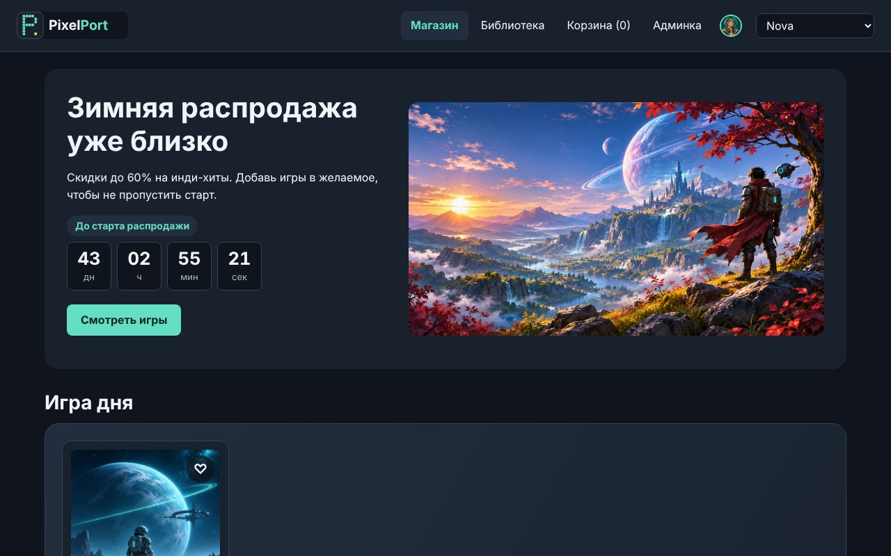

# PixelPort

Учебный магазин инди-игр в духе Steam: витрина с поиском и фильтрами, страница игры
с отзывами, корзина и заказы, библиотека игрока, админка и статистика продаж.
Игры, студии и цены вымышлены.



**Демо без сервера:** https://paltosik91.github.io/pixelport/ — витрина, страницы игр,
корзина и «Желаемое» работают по файлу `data/catalog.json`. Отзывы, заказы, админка
и статистика требуют сервера — запуск ниже.

## Возможности

**v1.0 — релиз**

- «Выбор редакции»: подборка магазина с бейджем на обложке, фильтр на витрине,
  флажок в админке ([тикет](docs/feature.md))
- Пометка «новинка» и оценка словами на карточках
- Понятное сообщение, если база не обновлена до последней миграции

**v0.3 — магазин с сервером** (ASP.NET Core, PostgreSQL)

- API на ASP.NET Core, каталог в PostgreSQL через EF Core и миграции
- Отзывы игроков и рейтинг, переключатель «Играю как…»
- Админка: новая игра, правка, скидки, удаление
- Заказы в транзакции, библиотека игрока
- «Вам может понравиться» — похожие игры по общим тегам
- Статистика продаж: выручка по жанрам, топ-5 игр

**v0.2 — живой магазин** (TypeScript): каталог из JSON со «скелетами» загрузки, поиск,
фильтры, сортировка, корзина и «Желаемое» в `localStorage`, промокоды, таймер распродажи.

**v0.1 — витрина** (HTML, CSS): пять страниц, тёмная тема на CSS-переменных, адаптивная вёрстка.

Подробно по версиям — в [CHANGELOG.md](CHANGELOG.md).

## Технологии

HTML, CSS, TypeScript 7 (без фреймворков) · ASP.NET Core Minimal API на .NET 10 ·
EF Core 10 + Npgsql · PostgreSQL 18.

## Как запустить с сервером

**Нужно:** Node.js 24 LTS, .NET SDK 10, PostgreSQL 18 и пустая база, к которой у тебя есть доступ
(владелец — твой пользователь PostgreSQL).

1. Склонируй репозиторий и собери фронтенд:

   ```bash
   git clone https://github.com/Paltosik91/pixelport.git
   cd pixelport
   npm install
   npm run build
   ```

2. В `server/appsettings.json` в строке `ConnectionStrings:PixelPort` укажи свой сервер,
   порт, базу и пользователя. **Пароль сюда не пиши** — он задаётся переменной окружения.

3. Собери сервер и создай таблицы:

   ```bash
   dotnet tool restore
   cd server
   dotnet build
   export PGPASSWORD='пароль_от_базы'
   dotnet ef database update
   ```

   `dotnet build` нужен **до** `dotnet ef`: в свежем клоне проект ещё ни разу не собирался.

4. Запусти:

   ```bash
   dotnet run
   ```

   Открой http://localhost:5080. При первом запуске сервер сам заполнит пустую базу:
   12 игр, 6 игроков, 60 отзывов и история продаж за 30 дней.

Примеры всех запросов к API — в `server/pixelport.http` (расширение REST Client для VS Code).

## Как запустить без сервера

`npm install`, `npm run build`, затем открыть папку через Live Server в VS Code.
Двойной щелчок по `index.html` не подойдёт: модули и `fetch` работают только через веб-сервер.

## Частые проблемы

| Сообщение | Причина и решение |
| --- | --- |
| `NETSDK1004: Assets file '…project.assets.json' not found` при `dotnet ef` | Проект не собран. В папке `server`: `dotnet build`, потом снова `dotnet ef database update` |
| `База не обновлена: не применены миграции …` | База отстаёт от кода. В папке `server`: `dotnet ef database update` |
| `No password has been provided but the backend requires one` | Не задан пароль: `export PGPASSWORD='…'` в том же окне терминала |
| `28P01: password authentication failed for user …` | Неверный пароль или пользователь в `appsettings.json` |
| `Failed to connect to 127.0.0.1:5432` | PostgreSQL не запущен или слушает другой порт — проверь порт в `appsettings.json` |
| `Failed to bind to address http://127.0.0.1:5080: address already in use` | Сервер уже запущен в другом окне — останови его (`Ctrl+C`) |
| Страница открылась, но отзывов и админки нет | Сайт открыт через Live Server, а не на `localhost:5080` — это режим без сервера |

## Устройство проекта

```text
index.html, game.html, …   страницы магазина
css/styles.css             стили
src/*.ts → js/*.js         TypeScript и собранный JavaScript (js/ в репозитории — для GitHub Pages)
data/catalog.json          каталог: начальные данные для базы и данные режима без сервера
server/                    ASP.NET Core: Program.cs, *Endpoints.cs — маршруты API
server/Data/               сущности EF Core, контекст PixelPortDb, сидер и начальные данные
server/Migrations/         миграции базы данных
db/                        SQL-скрипты: схема из работы №17, отчёты, похожие игры
docs/                      тикет своей функции, макет, сценарий демонстрации, чек-лист релиза
```

## API

| Запрос | Что делает |
| --- | --- |
| `GET /api/games?q=&genre=&maxPrice=&onlySale=&editorsChoice=&sort=` | Каталог с фильтрами |
| `GET /api/games/{id}` · `/similar` · `/reviews` | Игра, похожие игры, отзывы |
| `POST /api/games/{id}/reviews` | Новый отзыв |
| `GET /api/genres`, `GET /api/players` | Жанры, игроки |
| `POST /api/games` · `PUT /api/games/{id}` · `DELETE /api/games/{id}` | Админка: создать, изменить, удалить |
| `PUT /api/games/{id}/discount` · `/editors-choice` | Скидка, «Выбор редакции» |
| `POST /api/orders` · `GET /api/players/{id}/library` | Заказ, библиотека игрока |
| `GET /api/stats` | Статистика продаж |

Ошибки — в формате Problem Details (RFC 9110): 400 с ошибками по полям, 404, 409.

## Ограничения

Учебный проект: нет регистрации и входа — игрок выбирается в шапке, админка открыта всем.
Даты продаж группируются по UTC.

## Автор

Эталонный проект курса «Осуществление интеграции программных модулей», 2027.
