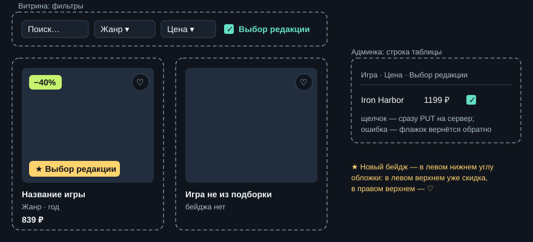

# PIX-100. Выбор редакции

**Автор:** Иван Иванов, ИС-31 · **Сложность:** ★★ · **Ветка:** `feature/editors-choice`
**Статус:** утверждён преподавателем

## История

Как **покупатель**, который не знает, во что поиграть, я хочу **видеть игры, которые советует сам магазин**, чтобы **быстрее выбрать что-то хорошее**.

Как **администратор**, я хочу **отмечать такие игры в админке**, чтобы **менять подборку без программиста**.

## Критерии приёмки

1. У игры из подборки на обложке — бейдж «★ Выбор редакции»: на витрине, в «Вам может понравиться» и на странице игры.
2. На витрине — флажок «Выбор редакции»: оставляет только игры подборки и работает вместе с остальными фильтрами. Без сервера (GitHub Pages) — тоже.
3. В админке у каждой игры — флажок «Выбор редакции». Щелчок сразу сохраняет на сервере; после перезагрузки страницы состояние то же. При ошибке сервера флажок возвращается в прежнее положение, и видно сообщение.
4. `PUT /api/games/999/editors-choice` → 404; запрос без поля `isEditorsChoice` → 400.
5. В новой базе подборка — Iron Harbor, Lantern Valley, Hollow Bell. В уже заполненной базе — те же три игры после миграции.
6. Отметка не меняет цену и порядок сортировки.

## Контракт API

| Запрос | Ответ |
| --- | --- |
| `GET /api/games?editorsChoice=true` | 200, только игры подборки; вместе с остальными параметрами |
| `GET /api/games`, `GET /api/games/{id}` | у каждой игры новое поле `isEditorsChoice: boolean` |
| `PUT /api/games/{id}/editors-choice`, тело `{ "isEditorsChoice": true }` | 200 и игра целиком; 400 — нет поля; 404 — нет игры |

## База данных

- Новый столбец `games.is_editors_choice boolean NOT NULL DEFAULT false`, миграция `AddEditorsChoice`.
- Данные: в новой базе подборку проставит сидер из поля `editorsChoice` в `catalog.json`; в уже заполненной — `UPDATE` внутри миграции. Без второго пути у всех, кто уже запускал проект, подборка окажется пустой.

## Затронутые слои

- [x] База данных — столбец, миграция, начальные данные
- [x] Сервер — `Game`, сидер, DTO, фильтр, новый `PUT`
- [x] Фронтенд — `models.ts`, `api.ts` (оба режима), фильтр, бейдж, админка
- [x] HTML/CSS — флажки, бейдж
- [ ] Новая страница — не нужна

## Макет

## План

| № | Шаг | Слой | Когда |
| --- | --- | --- | --- |
| 1 | Столбец, сидер, `catalog.json`, миграция | БД | №27 |
| 2 | Поле в DTO, параметр `editorsChoice` в `/api/games` | Сервер | №28 |
| 3 | `PUT /api/games/{id}/editors-choice`, запросы в `.http` | Сервер | №28 |
| 4 | Модели, `api.ts`, фильтр в обоих режимах | Фронтенд | №28 |
| 5 | Бейдж на карточке и на странице игры | Фронтенд, CSS | №28 |
| 6 | Флажок в админке | Фронтенд | №28 |
| 7 | Проверка всех критериев, PR | — | №28 |

## Не входит

- Несколько подборок («Выбор недели», «Хиты») и их названия.
- Свой порядок игр внутри подборки.
- Отдельная страница подборки.

## Риски и вопросы

- В левом верхнем углу обложки уже бейдж скидки, в правом — ♡. Новый бейдж — в левый нижний, чтобы не перекрывались.
- Без сервера админка не работает — менять подборку можно только с сервером, а показывать — в обоих режимах.
